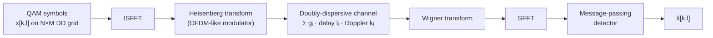
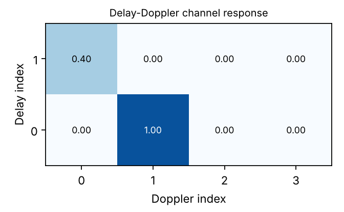
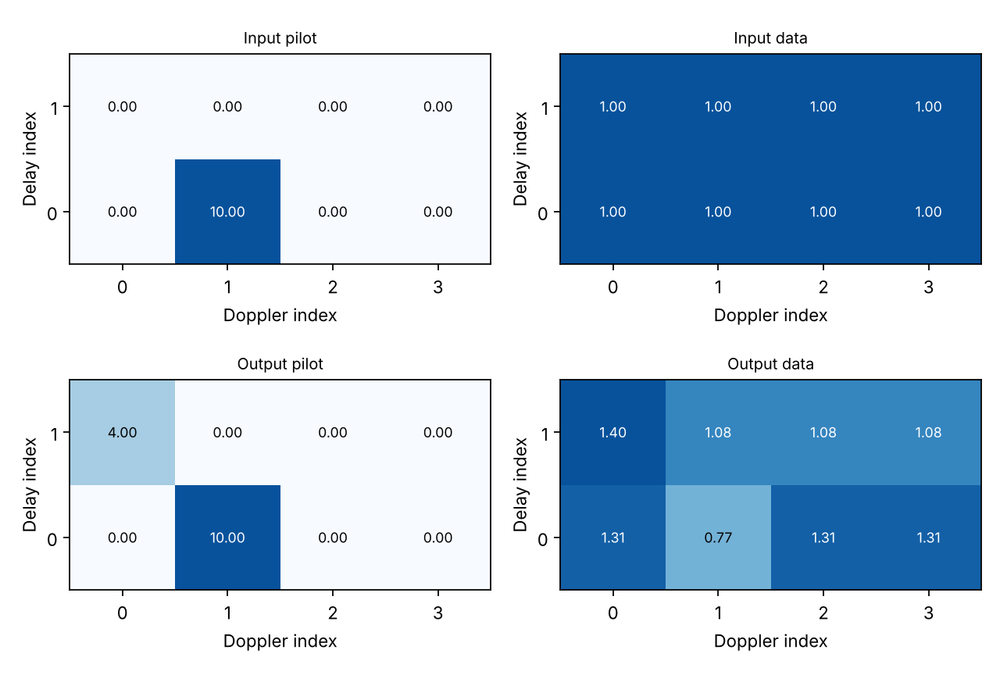
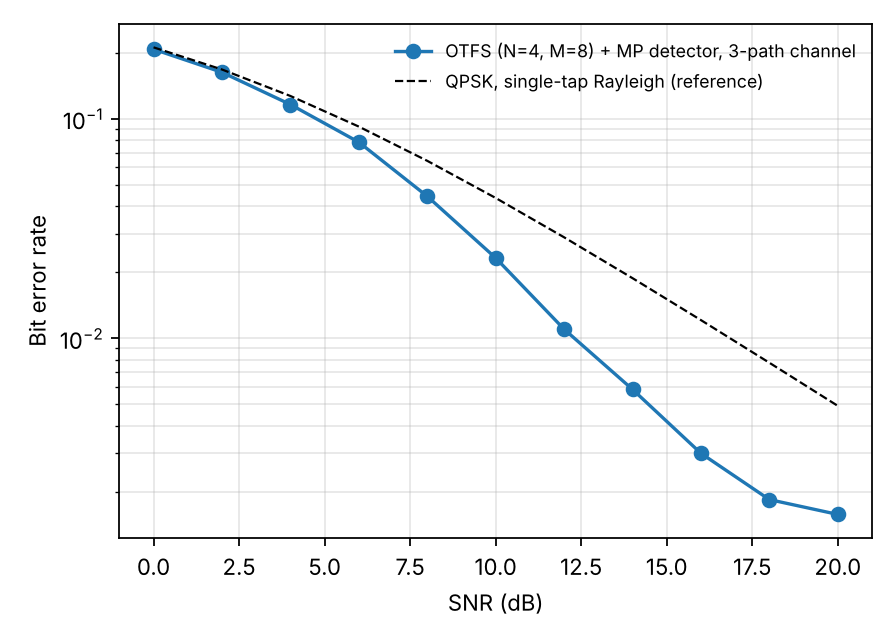

# Orthogonal Time Frequency Space (OTFS) Modulation: Delay-Doppler Channel Modelling and Message-Passing Detection

**Alirıza Bilir**
*2024*

---

> **Abstract.** Orthogonal frequency-division multiplexing (OFDM) performs well on frequency-selective channels but degrades in the presence of large Doppler spreads, as encountered in high-mobility and millimetre-wave links. Orthogonal time frequency space (OTFS) modulation addresses this by placing information symbols on a two-dimensional *delay-Doppler* grid, where a time-varying multipath channel becomes a sparse, quasi-static two-dimensional convolution and every symbol experiences approximately the same channel gain. This work develops a discrete OTFS transceiver model, constructs the effective delay-Doppler channel matrix from a set of propagation paths, and detects the transmitted QAM symbols with an iterative message-passing (MP) algorithm that exploits the sparsity of the channel. A small illustrative frame shows how a pilot and a data frame are spread by a two-path channel, and Monte-Carlo simulations over random three-path channels demonstrate a clear diversity advantage over single-tap Rayleigh fading, with the bit-error rate falling below $2 \times 10^{-3}$ at 18 dB.
>
> **Keywords:** OTFS, delay-Doppler domain, doubly-dispersive channel, high mobility, message passing, 5G/6G waveforms

---

## Contents

1. [Introduction](#1-introduction)
2. [Delay-Doppler Representation of the Channel](#2-delay-doppler-representation-of-the-channel)
3. [OTFS Transceiver Model](#3-otfs-transceiver-model)
4. [Message-Passing Detection](#4-message-passing-detection)
5. [Results](#5-results)
6. [Conclusion](#6-conclusion)
7. [Repository Structure and Usage](#7-repository-structure-and-usage)
8. [References](#references)

---

## 1. Introduction

The waveform transitions of past cellular generations — from analogue to TDMA, CDMA and finally OFDM — were each driven by new service requirements. Fifth-generation systems add use cases such as vehicle-to-everything (V2X) links, high-speed rail and millimetre-wave access, all of which suffer from large Doppler spreads. OFDM achieves capacity on frequency-selective channels only under assumptions that are not met in these regimes: its subcarriers lose orthogonality under Doppler, causing inter-carrier interference, and its per-subcarrier channel gains fluctuate strongly in time [1].

OTFS, introduced by Hadani *et al.* [1], modulates information in the delay-Doppler (DD) domain — closely related to the Zak representation of signals [2]. Because the physical reflectors that make up a propagation channel are characterised by a small number of nearly constant delays and Doppler shifts, the channel seen in this domain is *sparse* and *time-invariant* over a frame. Each information symbol is spread over the entire time-frequency plane of the frame, so OTFS can harvest the full delay and Doppler diversity of the channel; it can be interpreted as a generalisation of both OFDM and (DFT-spread) CDMA in which the spreading occurs over time *and* frequency [1], [3].

## 2. Delay-Doppler Representation of the Channel

Following Bello's characterisation of linear time-varying channels [4], the received signal can be written in terms of the delay-Doppler spreading function $h(\tau, \nu)$:

$$
r(t) = \iint h(\tau, \nu)\, e^{j 2\pi \nu (t - \tau)}\, s(t - \tau)\, d\tau\, d\nu + w(t).
$$

The received signal is thus a superposition of copies of the transmitted signal, each delayed by $\tau$, frequency-shifted by $\nu$ and weighted by $h(\tau, \nu)$. For a channel composed of $P$ dominant paths,

$$
h(\tau, \nu) = \sum_{i=1}^{P} g_i\, \delta(\tau - \tau_i)\, \delta(\nu - \nu_i),
$$

and on a discrete grid with delay resolution $1/(M\Delta f)$ and Doppler resolution $1/(NT)$, each path is described by an integer delay tap $l_i$ and Doppler tap $k_i$. Typical Doppler shifts range from tens of hertz to about a kilohertz, while delays span microseconds; both are essentially constant over a frame.

## 3. OTFS Transceiver Model

A frame of $NM$ QAM symbols $x[k, l]$ is arranged on an $N \times M$ delay-Doppler grid. The transmitter maps it to the time–frequency plane with the inverse symplectic finite Fourier transform (ISFFT) and then to a time-domain signal (Heisenberg transform); the receiver applies the inverse operations (Wigner transform followed by SFFT). For rectangular pulses the end-to-end relation in vectorised form becomes

$$
\mathbf{y} = \mathbf{H}_{\mathrm{DD}}\, \mathbf{x} + \mathbf{w},
\qquad
\mathbf{H}_{\mathrm{DD}} = \left(\mathbf{F}_N \otimes \mathbf{I}_M\right) \left( \sum_{i=1}^{P} g_i\, \boldsymbol{\Pi}^{l_i} \boldsymbol{\Delta}^{k_i} \right) \left(\mathbf{F}_N^{H} \otimes \mathbf{I}_M\right),
$$

where $\boldsymbol{\Pi}$ is the $NM \times NM$ cyclic-shift (delay) matrix, $\boldsymbol{\Delta} = \operatorname{diag}(e^{j2\pi n/NM})$, $n = 0,\dots,NM-1$, applies the Doppler phase ramp, and $\mathbf{F}_N$ is the normalised $N$-point DFT matrix. Each row and column of $\mathbf{H}_{\mathrm{DD}}$ contains only $P$ non-zero entries, so every received sample depends on just $P$ transmitted symbols — the sparsity that the detector exploits.

The MATLAB implementation in this repository builds $\mathbf{H}_{\mathrm{DD}}$ explicitly from the delay-time response $g_s[l, q] = \sum_i g_i\, z^{k_i (q - l_i)}\,\delta[l - l_i]$, $z = e^{j2\pi/NM}$, a permutation matrix that reorders samples between delay-time and delay-Doppler indexing, and Kronecker products with the DFT matrix.



## 4. Message-Passing Detection

Optimal maximum-likelihood detection over $\mathbf{H}_{\mathrm{DD}}$ is exponential in $NM$. Following Raviteja *et al.* [5], the sparse structure is represented as a factor graph with $NM$ variable nodes (symbols $x_c$) and $NM$ observation nodes ($y_d$), each connected to $P$ neighbours. For observation $d$, the interference from all symbols other than $x_c$ is approximated as Gaussian with mean and variance

$$
\mu_{d,c} = \sum_{e \in \mathcal{I}(d),\, e \ne c} \sum_{a \in \mathbb{A}} p_{e,d}(a)\, a\, H_{d,e},
$$

$$
\sigma^2_{d,c} = \sum_{e \in \mathcal{I}(d),\, e \ne c} \left( \sum_{a} p_{e,d}(a) |a|^2 |H_{d,e}|^2 - \left|\sum_{a} p_{e,d}(a)\, a\, H_{d,e}\right|^2 \right) + \sigma_w^2 .
$$

Each variable node then updates its probability mass function using the messages of all other connected observations,

$$
p_{c,d}(a) \propto \prod_{e \in \mathcal{J}(c),\, e \ne d} \exp\left( -\frac{|y_e - \mu_{e,c} - H_{e,c}\, a|^2}{\sigma^2_{e,c}} \right),
$$

with damping between iterations to aid convergence; the final decision maximises the same product taken over all connected observations. The complexity grows only linearly with $NM$ and $P$.

## 5. Results

### 5.1 Illustrative Frame

A $2 \times 4$ frame and a two-path channel with gains $g = [1,\ 0.4]$, delay taps $l = [0,\ 1]$ and Doppler taps $k = [0,\ -1]$ are used to visualise the DD-domain input–output relation.

<p align="center">
  
</p>
<p align="center"><em>Figure 1. Magnitude of the delay-Doppler channel: a direct path and a weaker path delayed by one bin and shifted by one Doppler bin.</em></p>

<p align="center">
  
</p>
<p align="center"><em>Figure 2. Top: transmitted pilot and QPSK data frames. Bottom: received frames. The single pilot is replicated at exactly the delay-Doppler offset of the second path with amplitude 0.4 × 10 = 4, revealing the channel directly; the data symbols are superimposed according to the same two-dimensional convolution.</em></p>

The received pilot frame (Figure 2, bottom-left) reproduces the channel of Figure 1, illustrating why OTFS supports compact, embedded pilot-based channel estimation. In this noiseless example the message-passing detector recovers all eight data symbols without error.

### 5.2 Bit-Error Rate

**Table 1.** Monte-Carlo parameters.

| Parameter | Value |
|---|---|
| Grid size | $N = 4$ Doppler bins × $M = 8$ delay bins |
| Modulation | QPSK (Gray) |
| Channel | 3 paths, $g_i \sim \mathcal{CN}(0, 1/3)$, $l_i \in \lbrace 0,\dots,3 \rbrace$, distinct $k_i \in \lbrace -2,\dots,2 \rbrace$ |
| Detector | Message passing, 15 iterations, damping 0.6 |
| Frames per SNR point | 3000 |

<p align="center">
  
</p>
<p align="center"><em>Figure 3. Bit-error rate of OTFS with message-passing detection over random three-path delay-Doppler channels, compared with QPSK over a single-tap Rayleigh channel.</em></p>

OTFS outperforms the single-tap Rayleigh reference across the SNR range, and the gap widens with SNR — from a factor of about 2 at 10 dB ($2.3 \times 10^{-2}$ vs. $4.4 \times 10^{-2}$) to about 3–4 at 16–20 dB. The steeper slope between 8 and 16 dB reflects the additional diversity collected from the resolvable delay-Doppler paths. At the highest SNRs the slope flattens, which is attributable to the small frame, to channel realisations in which paths fall on the same delay bin, and to the sub-optimality of Gaussian-approximation message passing; larger frames and more paths would increase the achievable diversity [5].

## 6. Conclusion

OTFS converts a doubly-dispersive channel into a sparse, quasi-static two-dimensional convolution in the delay-Doppler domain. A discrete transceiver model and its effective channel matrix were implemented, the input–output behaviour was visualised on an illustrative frame, and a message-passing detector exploiting the channel sparsity was shown to recover the transmitted symbols and to deliver a diversity gain over flat Rayleigh fading. These properties make OTFS a strong candidate waveform for high-mobility scenarios in 5G-Advanced and 6G. Embedded-pilot channel estimation, fractional Doppler, comparison with OFDM under identical conditions and MIMO-OTFS are natural extensions.

*Developed as a team project.*

## 7. Repository Structure and Usage

```
otfs-modulation-delay-doppler/
├── matlab/
│   ├── otfs_mp_detection.m        # main script: DD channel, pilot/data frames, MP detection, plots
│   ├── channels.m                 # delay-time and delay-Doppler channel matrices
│   ├── generate_dd_frame.m        # random QAM frame and pilot grid
│   ├── mod_frame.m / demod_frame.m
│   ├── generate_received_signal.m
│   └── non_null_index.m           # sparsity pattern of H for the factor graph
├── python/
│   └── otfs_sim.py                # NumPy re-implementation; regenerates all figures and BER curve
├── docs/figures/
├── requirements.txt
└── LICENSE
```

```matlab
% MATLAB (Communications Toolbox for qammod)
cd matlab
otfs_mp_detection
```

```bash
# Python
pip install -r requirements.txt
python python/otfs_sim.py --frames 3000
```

The MATLAB message-passing routine builds on an openly available OTFS reference implementation and was adapted and documented for this study; the Python version is an independent, vectorised re-implementation.

---

## References

[1] R. Hadani, S. Rakib, M. Tsatsanis, A. Monk, A. J. Goldsmith, A. F. Molisch and R. Calderbank, "Orthogonal time frequency space modulation," in *Proc. IEEE Wireless Communications and Networking Conference (WCNC)*, San Francisco, 2017.

[2] A. J. E. M. Janssen, "The Zak transform: A signal transform for sampled time-continuous signals," *Philips Journal of Research*, vol. 43, no. 1, pp. 23–69, 1988.

[3] Z. Wei *et al.*, "Orthogonal time-frequency space modulation: A promising next-generation waveform," *IEEE Wireless Communications*, vol. 28, no. 4, pp. 136–144, 2021.

[4] P. Bello, "Characterization of randomly time-variant linear channels," *IEEE Transactions on Communications Systems*, vol. 11, no. 4, pp. 360–393, 1963.

[5] P. Raviteja, K. T. Phan, Y. Hong and E. Viterbo, "Interference cancellation and iterative detection for orthogonal time frequency space modulation," *IEEE Transactions on Wireless Communications*, vol. 17, no. 10, pp. 6501–6515, 2018.
